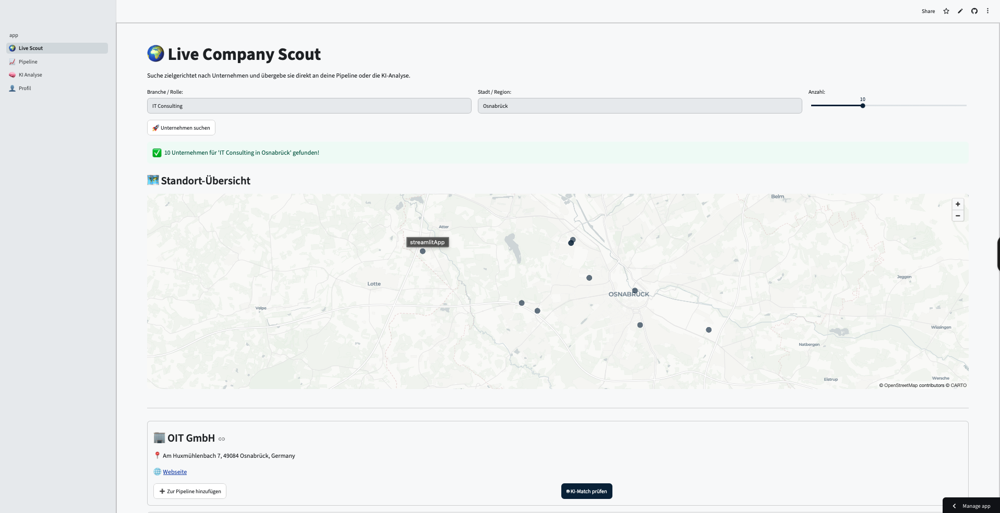
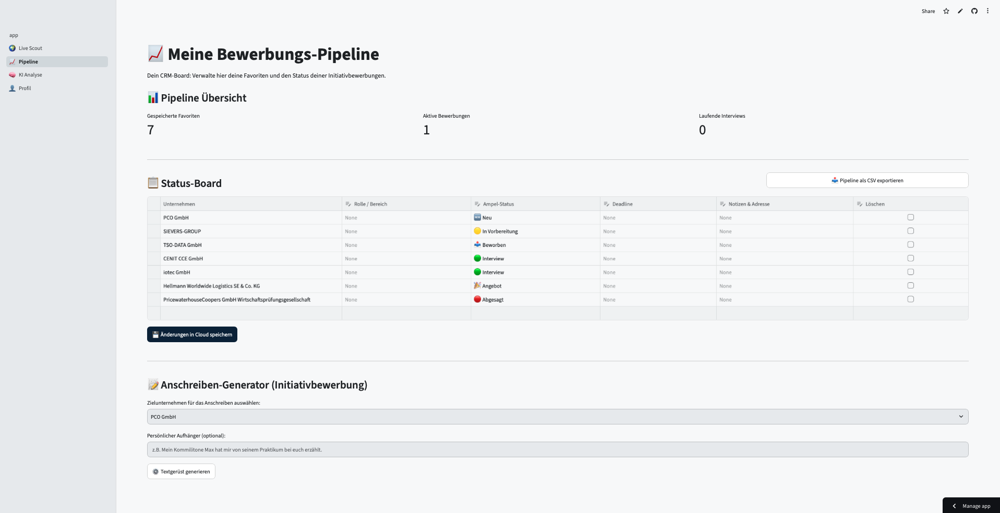

# Personal Job Scout

Hi, ich bin Bo und studiere Wirtschaftsinformatik an der Hochschule Osnabrück. 

Ich habe dieses Tool gebaut, weil ich eine strukturierte Lösung für meine Initiativbewerbungen im Bereich IT Consulting und PMO gesucht habe. Eine einfache Excel Liste war mir dafür zu langweilig und unflexibel. 

Außerdem wollte ich potenziellen Arbeitgebern direkt zeigen, was ich kann. Anstatt nur in meinem Lebenslauf zu behaupten, dass ich mich für Cloud Architekturen, Datenbanken und KI interessiere, wollte ich ein echtes funktionierendes Vorzeigeprojekt haben. Da ich neben dem Studium im IT Operations Bereich arbeite, lag der Fokus für mich auf einem Tool, das nicht nur gut aussieht, sondern auch stabil läuft und Fehler sauber abfängt.

## Was das Tool besonders macht

Mir war wichtig, dass die App unter der Haube robust funktioniert.

Fail Fast: Externe LLM APIs sind oft überlastet. Die App hängt sich dann nicht endlos auf, sondern hat feste Timeouts nach 15 Sekunden. Wenn ein Modell nicht antwortet, springt der Code direkt zum nächsten.

Effiziente API Nutzung: Bei der Google Places API frage ich nur exakt die Daten ab, die ich auch brauche, inklusive der Koordinaten für die Karte. So vermeide ich Datenmüll und halte die Kosten auf Null.

State Management: Damit beim Wechseln der Seiten in Streamlit keine Daten verloren gehen, speichere ich alle wichtigen Infos im Session State. So kann ich eine URL direkt aus der Suche in das Analyse Modul übergeben.

Datenbank: Ich nutze keine lokalen Dateien, sondern Supabase als echte PostgreSQL Cloud Datenbank für alle meine Favoriten und Profilinformationen.

## Mein Tech Stack

Frontend: Python und Streamlit
Datenbank: Supabase
APIs: Google Places API New und Jina Reader API für das Web Scraping
KI und Datenverarbeitung: Google GenAI SDK mit Gemini 3.8 Pro, Gemini 3.8 Flash und Gemini 2.0 Flash, PyPDF2 und Pandas

## Die Module

1. Live Scout
Eine Suchmaschine, die Firmen nach Branche und Ort sucht. Die Ergebnisse landen direkt auf einer interaktiven Karte und können per Klick in meine Datenbank gespeichert werden.

2. Pipeline
Mein CRM Board für alle Bewerbungen. Hier gibt es auch einen Anschreiben Generator. Der baut mir aus meinen hinterlegten Skills und der Zielrolle ein ehrliches und geerdetes Anschreiben zusammen.

3. KI Analyse
Ein Web Scraper liest die Homepage der Zielfirma aus. Gemini vergleicht dann die Ausrichtung der Firma mit meinem Profil und zeigt mir, wo meine Stärken liegen und was vielleicht noch fehlt.

4. Profil Editor
Hier lade ich meinen PDF Lebenslauf hoch. Der Text wird extrahiert und zusammen mit meinen weiteren Zielen in der Cloud gespeichert.

## Setup für lokales Ausführen

Falls ihr euch das Tool nicht nur im Code ansehen wollt, sondern selbst testen möchtet wie es in der Praxis funktioniert, könnt ihr es ganz einfach lokal bei euch starten.

1. Repository klonen:
git clone https://github.com/bobaum/pro-company-scout.git
cd pro-company-scout

2. Abhängigkeiten installieren:
pip install -r requirements.txt

3. Secrets anlegen:
Erstelle im Ordner .streamlit eine Datei namens secrets.toml mit folgendem Inhalt:
SUPABASE_URL = deine_supabase_url
SUPABASE_KEY = dein_supabase_key
PLACES_API_KEY = dein_google_places_key
GEMINI_API_KEY = dein_gemini_key

4. App starten:
streamlit run app.py
